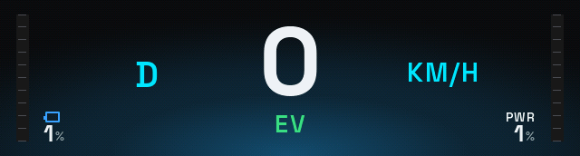
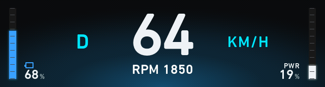
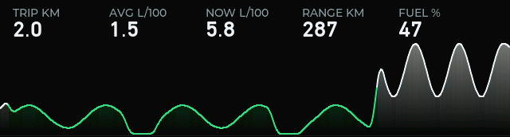
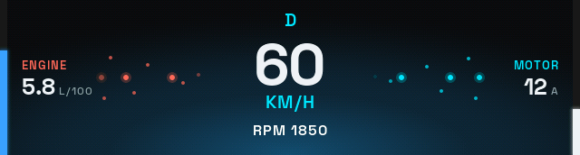
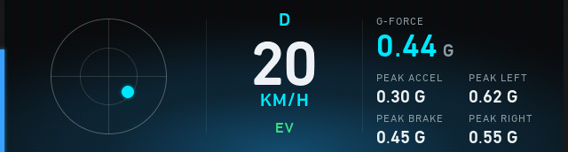
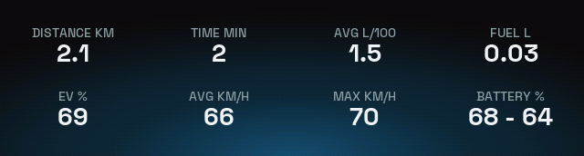

# Toyota Yaris (3rd Gen / XP130) — Virtual Cockpit



A digital instrument cluster for a 2014 Toyota Yaris Hybrid, driven by the
car's own CAN bus, reverse-engineered from scratch.

- `firmware/` — the dashboard (ESP32-S3, LVGL 8.3) and a desktop simulator
- `re/` — CAN sniffer firmware, analysis scripts, sample logs and findings
- `dbc/` — the decoded signals as a DBC file
- `3d/` — Fusion 360 and 3MF files for the enclosure

> **Safety.** The firmware only listens to the bus (`TWAI_MODE_LISTEN_ONLY`):
> it cannot send anything to the car. Still, read the bring-up procedure in
> [`re/obd-capture-fw/README.md`](re/obd-capture-fw/README.md) before
> connecting to a running car.

## Screens

Press the board's BOOT button or tap the panel to switch screen. Speed, gear
and RPM or EV stay on every screen: leaving the cockpit, they slide into a
narrow column in the middle and the side gauges shrink to thin rails on the
screen edges.

**Cockpit** — speed, gear (or 0–50 / 0–100 timer), RPM or EV, HV battery
charge on the left, CHG/PWR on the right. With the engine off the PWR readout
shows battery amps.



**Efficiency** — trip distance and the whole drive's power demand as one
curve, green on electric and white on the engine, left of the speed; average
and instantaneous consumption, range and fuel level right of it.



**Energy flow** — engine consumption on the left, HV battery current on the
right, and particles funnelling from each source into the speed, or out of it
in green while the battery charges. The directions come from the car's own
energy-monitor flags.



**G-meter** — longitudinal and lateral acceleration from the board's IMU,
with the session's peaks.



**Trip summary** — comes up by itself when the car is switched off, for the
seconds the board stays powered.



## Hardware

- Waveshare ESP32-S3-Touch-LCD-3.49 (640×172 strip, onboard QMI8658 IMU)
- SN65HVD230 CAN transceiver — wiring in
  [`re/obd-capture-fw/README.md`](re/obd-capture-fw/README.md)

## Build

Needs [PlatformIO](https://platformio.org/).

```sh
cd firmware
pio run -t upload            # dashboard
pio run -e demo -t upload    # same UI replaying a recorded drive, no car needed
```

Desktop simulator (SDL2, no board): see
[`firmware/sim/README.md`](firmware/sim/README.md).

## Capturing the bus

The dashboard can stream every CAN frame over USB while it keeps running:

```sh
pip install pyserial
python3 re/tools/usb_stream_logger.py /dev/cu.usbmodem1101 --settime
```

Logs land in `re/data/logs/` in `candump` format. A standalone sniffer that
logs to SD is in [`re/obd-capture-fw/`](re/obd-capture-fw/).

## Decoded signals

- [`dbc/toyota_yaris_xp130_reversed.dbc`](dbc/toyota_yaris_xp130_reversed.dbc) — the signals
- [`re/docs/decoded_signals_summary.md`](re/docs/decoded_signals_summary.md) — quick table
- [`re/docs/signal_findings.md`](re/docs/signal_findings.md) — method and evidence
- [`re/docs/capture_survey.md`](re/docs/capture_survey.md) — full sweep of all IDs, open questions

## Status

A hobby project on a single car: signal mappings may not carry over to other
years or markets, and several scales are derived rather than checked against
a diagnostic tool. No license chosen yet.
